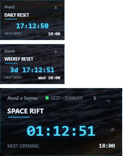
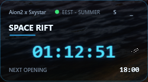
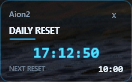
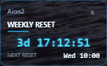

# AION 2 Space Rift Overlay

A small, dark, translucent floating countdown overlay for **AION 2** "Space Rift"
openings in Sofia time. Standalone WPF desktop app - it does **not** inject into
the game, read game memory, modify game files, or automate gameplay.

- Header: `Aion2 x Sxystar`, schedule status (EEST/EET), settings button, minimize button
- Large cyan countdown in `HH:MM:SS`, updated once per second
- ``NEXT OPENING`` - next opening in local Sofia time (``HH:mm``)
- Mini overlays for **Daily Reset** (07:00 UTC) and **Weekly Reset** (Wednesday 07:00 UTC), toggled from the settings panel
- Voice alerts: a clip 10 minutes before each opening and one at the opening
- Click the settings button (S) to open the settings panel
- Dark translucent backdrop with rounded corners; text stays fully opaque

## Screenshots

All three overlays as they appear in game:




Space Rift countdown overlay:



Mini overlays for the Daily and Weekly Reset (enabled from the settings panel):




*The translucent backdrop shows the desktop behind it; the countdown text stays fully opaque.*

## Requirements

- Windows 10/11 x64
- To **build**: .NET 8 SDK (this workspace keeps a portable SDK in `.dotnet\`)
- To **run a published exe**: nothing else - it is self-contained
- To **run from source** without publishing: .NET 8 Desktop Runtime

## Time zone & schedule

Openings are defined in local Sofia wall-clock time
(time zone `FLE Standard Time` on Windows / `Europe/Sofia` IANA; the app falls
back to a fixed UTC+2 zone only if both lookups fail):

- **Summer (EEST, UTC+3):** 00:00, 03:00, 06:00, 09:00, 12:00, 15:00, 18:00, 21:00
- **Winter (EET, UTC+2):** 02:00, 05:00, 08:00, 11:00, 14:00, 17:00, 20:00, 23:00

DST rules come from the Windows time-zone database - the app never hardcodes
offsets per month. Policies (implemented in `RiftScheduleService` and covered by
unit tests):

1. The schedule for a given local date is chosen by the DST state of that date
   at local 12:00 noon (a time never inside a transition).
2. A scheduled local time skipped by spring-forward (e.g. 03:00 on the last
   Sunday of March) produces **no opening** that day.
3. A time repeated by fall-back is interpreted at its second (standard-time)
   occurrence; in practice no scheduled time falls inside Bulgaria's repeated hour.
4. An opening exactly at the current instant counts as the **current** opening;
   the overlay shows the next strictly later opening (so at exactly 15:00:00 the
   countdown jumps to the 18:00 slot).
5. The remaining time is recomputed from the current clock every second - there
   is no decrementing counter, so clock changes and sleep/resume self-correct.

Settings are stored in `%LOCALAPPDATA%\Aion2RiftOverlay\settings.json`
(window position, opacity, always-on-top, lock position, minimize-to-tray,
settings-panel state). Malformed files fall back to safe defaults.

## Build

```powershell
# from the workspace root (i:\Aion2RiftOverlay)
.dotnet\dotnet.exe build Aion2RiftOverlay.sln
.dotnet\dotnet.exe test tests\Aion2RiftOverlay.Tests\Aion2RiftOverlay.Tests.csproj
```

If you have a system-wide .NET 8 SDK, plain `dotnet build` / `dotnet test` work too.

## Run from VS Code / command line

```powershell
.dotnet\dotnet.exe run --project src\Aion2RiftOverlay\Aion2RiftOverlay.csproj
```

Or open the folder in VS Code, open `MainWindow.xaml` / any `.cs` file, and
launch the command above in a terminal. Stop it with the settings panel's
**CLOSE APP** button or the tray icon's **Exit** item.

## Making your own .exe (from this repo)

Anyone can build the standalone exe in three steps:

**1. Get the code** - clone it, or use the green *Code > Download ZIP* button on GitHub:

```powershell
git clone https://github.com/VladislavHristov/Aion2Timers.git
cd Aion2Timers
```

**2. Install the .NET 8 SDK** (skip if you have it - check with `dotnet --list-sdks`):

```powershell
# Option A - system-wide (winget):
winget install Microsoft.DotNet.SDK.8

# Option B - portable, no admin required (repo helper script):
powershell -ExecutionPolicy Bypass -File .\dotnet-install.ps1 -Channel 8.0 -InstallDir .\.dotnet
```

If you used Option B, replace `dotnet` with `./.dotnet/dotnet.exe` in the commands below.

**3. Publish** - one command builds a self-contained single-file exe (no .NET Desktop
Runtime is needed on the PC where it will run):

```powershell
powershell -ExecutionPolicy Bypass -File .\publish.ps1
```

Result: **`publish\Aion2RiftOverlay.exe`** - a single ~154 MB file you can copy to any
Windows 10/11 x64 machine. The voice-alert sounds are already embedded in it and are
extracted automatically on first launch (see *Custom voice sounds* below for how to
swap them).

Optional - run the test suite before publishing:

```powershell
dotnet test tests\Aion2RiftOverlay.Tests\Aion2RiftOverlay.Tests.csproj
```

Manual publish command (same thing the script does, useful in CI):

```powershell
dotnet publish src\Aion2RiftOverlay\Aion2RiftOverlay.csproj -c Release -r win-x64 --self-contained true -p:PublishSingleFile=true -p:IncludeNativeLibrariesForSelfExtract=true -p:DebugType=none -o publish
```

## Usage

- **Drag** the overlay anywhere (drag on empty background areas).
- **Settings (S button):**
  - *Opacity* slider: 20-100 %, default 85 %. Applies to the translucent
    backdrop; the countdown text is always fully opaque for readability.
- Tray icon: double-click shows the overlay; right-click offers *Show overlay*
  and *Exit*.

## Custom voice sounds (no recompile needed)

Sound files are resolved in this priority order:

1. **settings.json** - full paths in `tenMinuteWarningFile` / `openingSoundFile`
   (`%LOCALAPPDATA%\Aion2RiftOverlay\settings.json`), used only if the file exists.
2. **`sounds` folder next to the exe** - create `sounds\` beside
   `Aion2RiftOverlay.exe` and drop `10minutes.mp3` / `OpenNow.mp3` (or your own
   WAV/MP3 files with those names). This folder is created automatically on
   first launch and is the easiest way to swap voices - perfect for a compiled
   exe from a GitHub release.
3. **Embedded defaults** - the sounds bundled in `src/Aion2RiftOverlay/Sounds/`
   are compiled INTO the exe and extracted (overwritten) to
   `%LOCALAPPDATA%\Aion2RiftOverlay\sounds` on every startup. If you clone this
   repo, replace the MP3s in that folder and rebuild, your new voices are baked
   into the exe.
  - *Always on top* - default on.
  - *Lock position* - disables dragging.
  - *Minimize to system tray* - the minimize button then hides the window to
    the tray; restore via tray double-click or the tray menu.
  - *RESET POSITION* - recenters the overlay on the current screen.
  - *CLOSE APP* - reliable exit.
- The window position is saved (debounced) and restored on the next launch;
  invalid saved positions are clamped into the visible work area, including
  after monitor/resolution changes.
- Tray icon: double-click shows the overlay; right-click offers *Show overlay*
  and *Exit*.

## Troubleshooting

- **Countdown wrong**: system time zone must contain "FLE Standard Time" (any
  recent Windows 10/11 does). If time-zone data is broken the app falls back to
  a fixed UTC+2 schedule without DST.
- **Overlay hidden behind the game**: enable *Always on top*, use Borderless
  Windowed mode. Exclusive fullscreen games may cover overlays entirely.
- **Window lost off-screen**: click tray icon, then use *RESET POSITION*, or
  delete `%LOCALAPPDATA%\Aion2RiftOverlay\settings.json`.
- **Windows SmartScreen warning** on first run of the published exe: unsigned
  build - click *More info > Run anyway*.

## Project structure

```
Aion2RiftOverlay.sln
src/Aion2RiftOverlay/            WPF app (net8.0-windows)
  App.xaml(.cs)                  application + global exception handler
  MainWindow.xaml(.cs)           frameless overlay window mechanics
  Models/AppSettings.cs          persisted settings model
  Services/RiftScheduleService.cs  schedule + next-opening calculation
  Services/SettingsService.cs    JSON persistence (atomic writes)
  ViewModels/MainViewModel.cs    display state, MVVM-style
tests/Aion2RiftOverlay.Tests/    xUnit tests (schedule + settings)
publish.ps1                      one-command release build
```


